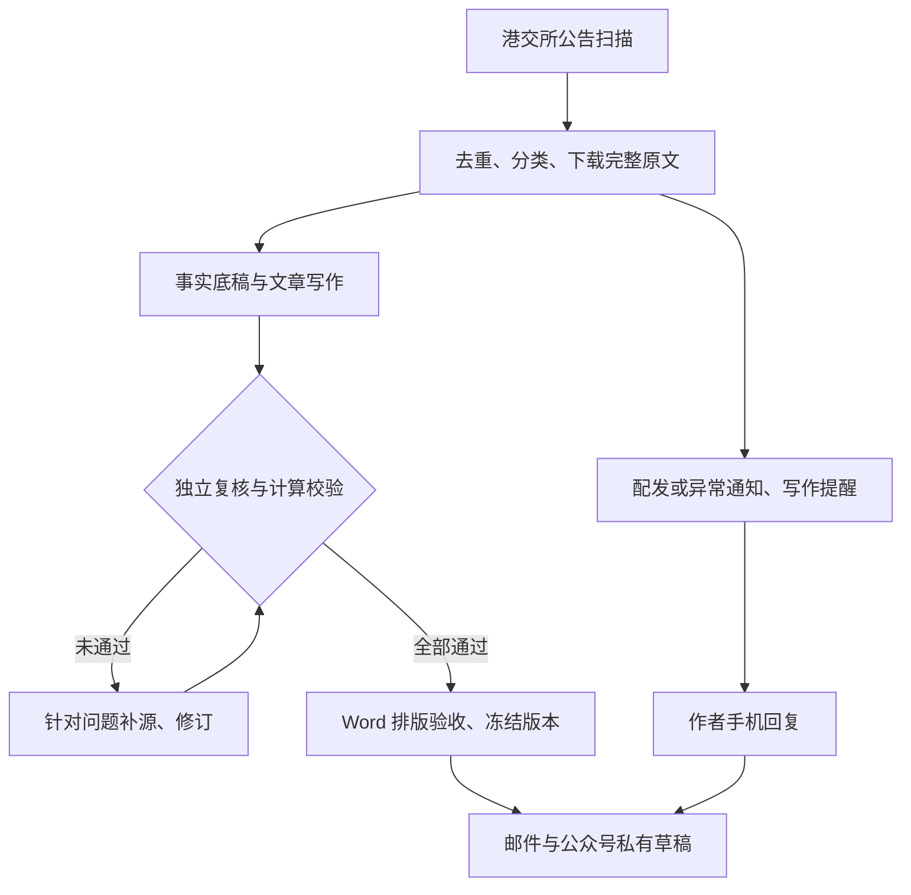

# 港股新股文章工作流

从港交所公告发现新股，核对完整原文，生成简洁的中文分析，再交给独立审核。审核通过后输出 Word、邮件和公众号**私有草稿**，最终发表由作者决定。

## 工作流



- **事实严谨，正文简洁**：完整保留证据和计算；正文挑重点，小数最多两位，陌生缩写用白话说明。
- **针对问题逐步收敛**：保留已通过内容，修订未通过项；真实缺口继续补源，结果不确定时暂停投递。
- **内容和投递分开**：扫描、写作、投递分别运行；首次扫描只建基线，避免批量发送历史文章。
- **可追溯**：来源、审核、版本和投递回执保存在本地；超时后的不确定投递不盲目重发。

## 开始使用

需要 Python 3.11+。写作使用已登录的 Codex CLI；Word 视觉验收另需 LibreOffice 和中文字体。手机排版检查使用 Node.js 20+、Playwright。

```bash
git clone https://github.com/jeffinchina/hkipo-workflow.git
cd hkipo-workflow
python3 -m venv .venv
source .venv/bin/activate
python -m pip install -e .
python scripts/configure.py
python -m hkipo service --config config/service.json --scan --classify
```

上述命令只扫描、下载和分类。启用写作、邮件或公众号草稿前，请按[配置与运行说明](docs/operations.md)完成本机配置和实际验收。

## 项目内容

| 目录 | 内容 |
| --- | --- |
| `runtime/hkipo` | 扫描、证据、写作、复核、修订、渲染与投递代码 |
| `runtime/tests` | 离线回归测试及测试素材 |
| `skills/hkipo-editor` | 写作技能与体裁规范 |
| `docs/writing-guide.md` | 简洁写作、数字显示和排版规范 |
| `examples` / `scripts` | 无敏感信息的配置样例和运行工具 |

## 隐私与验证

公开仓库不包含真实邮箱、账号密钥、个人二维码、封面、文章草稿、数据库或投递记录。请把个人配置放入已忽略的 `private/` 和 `config/`；测试图片是合成占位图，不是可用二维码。

```bash
python scripts/run_tests.py
python scripts/privacy_scan.py
```

该仓库保留完整工作流代码，不附带任何已登录账号、模型额度、个人素材或历史运行数据。项目更新沿用脱敏检查后提交同步的方式，并保持仓库现有可见性。
